<!-- Header -->

  

<!-- Typing intro -->

  

<!-- Tech stack -->
<h3 align="center">tech stack</h3>

  

<!-- Stats + top languages (generated daily by .github/workflows/grs.yml) -->
<h3 align="center">github stats</h3>

  
  

<!-- Streak -->

  

<!-- Activity graph -->

  

<!-- Snake (generated daily by .github/workflows/snake.yml) -->

  

<!-- Socials -->

  
  

<!-- Footer -->

  

